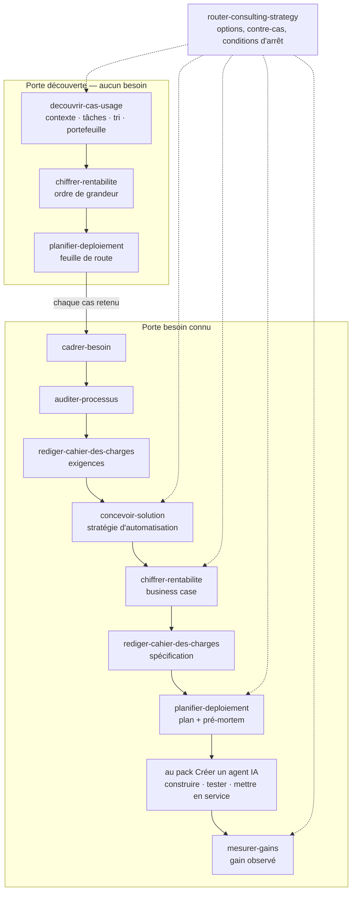

# consultant-ia

**Le pack du consultant IA et automatisation : décider, puis mesurer.** Neuf compétences
(plus un routeur de stratégie, un module CRM, un module de déploiement d'un assistant IA et un entretien guidé par IA) pour Claude Code et Cowork qui mènent
le conseil : comprendre le travail réel, trouver ce qui mérite d'être automatisé, comparer les solutions (dont ne
rien construire), chiffrer, spécifier et planifier, puis, une fois la solution en service, mesurer ce qu'elle
rapporte vraiment. Construire, tester et mettre en service sont au pack Créer un agent IA (voir plus bas).

---

## Le problème

Une mission « IA » part presque toujours d'une solution : « il nous faut un chatbot », « on veut un
agent ». Ou d'aucune idée précise : « l'IA, ça pourrait nous aider, mais où ? ». Dans les deux cas,
les mêmes erreurs coûtent cher :

1. **On automatise ce qu'il aurait fallu supprimer.** Une mauvaise habitude automatisée reste une
   mauvaise habitude, plus rapide et plus difficile à voir.
2. **On choisit l'outil avant le problème.** Le bon réflexe est la question « quel est le chemin le
   plus simple pour exécuter cette tâche ? », pas « comment je le fais dans tel outil ? ».
3. **On annonce des gains qu'on n'a jamais mesurés.** Un retour sur investissement sans mesure de
   départ ne se défend pas six mois plus tard, et les traces d'un outil (« 3 000 exécutions
   réussies ») ne disent pas ce qu'il rapporte.
4. **On touche un outil réel sans savoir comment revenir en arrière.** Une action faite sans
   validation précise, ou une bascule sans retour arrière, se paie le jour de l'incident.

Ce pack donne à l'IA la méthode d'un consultant : des étapes dans l'ordre, des livrables qui servent
à décider, et une discipline sur les chiffres comme sur les actions.

## Deux portes d'entrée

| Vous… | Tapez | Le pack enchaîne |
|---|---|---|
| **avez un besoin** (« automatiser la relance des factures ») | `/mission-besoin <le besoin>` | besoin cadré → diagnostic du processus → exigences → solutions comparées → rentabilité → spécification → plan ; puis, au pack Créer un agent IA, construction en essai → recette → mise en service ; puis mesure ici |
| **n'avez pas encore de besoin** (« où l'IA peut-elle nous aider ? ») | `/mission-decouverte` | contexte branché → cartographie des tâches → tri → portefeuille de cas d'usage → chiffrage → feuille de route |

Chaque cas retenu par la découverte repart ensuite par la porte « besoin connu ».



## Après le plan : le pack Créer un agent IA

Quand `70-plan.md` est validé, la mission passe au pack Créer un agent IA (plugin `creer-un-agent-ia`, workflow du site
[Créer un agent IA](https://zerogravity.builders/marketplace/workflow/creer-un-agent-ia), ou
[Créer une app](https://zerogravity.builders/marketplace/workflow/creer-une-app) quand la solution est une
application). Il prend `60-specification.md` et `70-plan.md` en entrée, construit, teste et met en service, et écrit
`80-construction.md`, `85-recette.md` et `90-mise-en-service.md` dans le même dossier de mission : le contrat des
fichiers ne change pas. Quand `90-mise-en-service.md` est validé au journal, la mesure reprend ici
(`mesurer-gains`, `95-mesure.md`). La porte affiche ces étapes « au pack Créer un agent IA » et dit comment l'appeler ;
elle ne les lance plus elle-même. `construire-solution` et `tester-solution` ont quitté ce pack le 09/11/2026 ;
`piloter-mise-en-service` les a suivies le même jour : la mise en service est au pack Créer un agent IA.

## Les neuf compétences du pack

| Compétence | Ce qu'elle produit |
|---|---|
| `router-mission-ia` | l'état de la mission, la porte, l'étape suivante, le journal des décisions |
| `decouvrir-cas-usage` | fiche entreprise, cartographie des tâches, tri en cinq issues, portefeuille de cas d'usage classés |
| `cadrer-besoin` | une fiche besoin courte : vrai problème, décision, périmètre, critères de succès, et le nom du dossier du cas |
| `auditer-processus` | le diagnostic du processus actuel : mesures, goulets, causes, ce qu'on simplifie d'abord |
| `rediger-cahier-des-charges` | les exigences (avant le choix) puis la spécification de la solution retenue |
| `concevoir-solution` | la stratégie d'automatisation (faire ou non, quel type de solution, quelle plateforme), des options réellement différentes, y compris ne rien construire, et une recommandation |
| `chiffrer-rentabilite` | gains, coûts, maintenance, délai de retour, en trois scénarios et hypothèses visibles |
| `planifier-deploiement` | feuille de route (avec son socle commun) ou plan de déploiement : simplifications, porte, pilote, adoption, mesure, pré-mortem |
| `mesurer-gains` | la lecture des relevés réels, le gain observé, les coûts réels, et la décision : continuer, corriger, étendre ou arrêter |

Sont au pack Créer un agent IA, sous leur nom court : `construire-solution` (la solution construite par tranches
dans un environnement d'essai, avec sa fiche d'exploitation), `tester-solution` (la recette critère par critère,
l'évaluation de l'IA à part, un verdict) et `piloter-mise-en-service` (chaque action sur un outil réel proposée avec
son retour arrière, le pilote, la bascule, l'adoption, le transfert à un exploitant). Leurs anciens dossiers sont
archivés dans `.archive/2026-11-09/`.

## Le module CRM

Quand le besoin touche au CRM (l'auditer, en choisir un, le mettre en place, le refondre), `auditer-crm` commence par
relever l'usage réel : volumes, quotas et limites de l'abonnement. Il audite ensuite quatre volets (automatisations et
intégrations, données, ventes, tableaux de bord) ; chaque constat dit sur quel écran, quel export ou quel entretien il
repose. Le bilan ne garde que les recommandations, les gains rapides en tête. Pour une mise en place ou une refonte,
le cahier des charges reste dans le modèle d'exigences du pack, avec ses annexes : pipelines, droits, catalogue,
raisons de perte.

L'agent `auditeur-crm` mène l'audit en lecture seule et s'arrête avant toute action dans le CRM. Ses questions sont
dans la base : `crm` pour l'existant, `crm-parametrage` pour le paramétrage, réservé aux questionnaires préparés avec
le consultant.

## Le déploiement d'un assistant IA

Quand une entreprise veut équiper une équipe d'un assistant (Claude, ChatGPT, Copilot ou un autre) sans nommer de
processus à automatiser, le pack prend un parcours court : la fiche besoin, puis `deployer-assistant-ia`, puis la mise en
service au pack Créer un agent IA, puis la mesure ici. Le module part de l'usage déjà là, compare l'option de ne rien ajouter et deux candidats sur des
faits relus le jour même aux pages officielles, écrit une charte d'une page, prépare le dossier de conformité sans
conclure à la place du rôle compétent, liste les réglages, prévoit le pilote, la formation par rôle et le rendez-vous de
pilotage. Il n'annonce aucun gain : la mesure le dira, sur relevé.

## L'entretien guidé par IA

Quand la personne à interroger n'a pas une heure à donner au consultant, ou vit à six fuseaux horaires,
`mener-entretien-ia` fait mener l'entretien par écrit par une IA, au rythme de la personne. Quand l'objectif est
nommé (« un agent qui réponde à nos clients »), l'agent prépare d'abord le questionnaire de cet objectif : il lit
tout ce qui lui est accessible, ne pose pas ce qui est établi, fait confirmer ce qui est incertain, et réécrit le
reste dans les mots de la personne, douze questions au plus, tirées du cadrage de `cadrer-besoin` et de son module
par domaine (service client, prospection, CRM, données, reporting, contenu, transmission). Le consultant valide ce
questionnaire avant l'entretien. Sans objectif encore, ce sont les guides de la découverte. L'IA pose une question
à la fois, dans la langue de la personne, avec une relance quand la réponse est vague (« la dernière fois, que
s'est-il passé ? », « à peu près combien par semaine ? »). Elle ne promet rien, ne donne ni prix ni outil, et ne
garde aucun nom. À la fin, elle fait valider un récapitulatif, puis rend un compte rendu que le script transforme
en note `mission/sources/entretien-<rôle>-<date>.md`, au format des autres notes :

```bash
python skills/mener-entretien-ia/scripts/entretien.py consigne --questionnaire mission/sources/questionnaire-support-client-2026-10-28.md --role "dirigeante" --entreprise "Société Exemple"
python skills/mener-entretien-ia/scripts/entretien.py note --compte-rendu cr.json --questionnaire mission/sources/questionnaire-support-client-2026-10-28.md --transcription messages.json --sortie mission/sources
```

Deux modes, une seule méthode : **en ligne**, la consigne se donne à un hôte qui accepte une consigne système et un
outil (un projet Claude, une page web derrière connexion) ; **en local**, la session Claude Code ou Codex de
l'entreprise mène l'entretien elle-même, après avoir lu ses dossiers et ses outils, et ne demande que ce qui reste.
Seul change ce que l'agent a pu lire ; les données lues restent chez l'entreprise. Le contrôle refuse une note dont un nombre dit de mémoire passerait pour un fait,
et la transcription sort adresses et numéros retirés. Le consultant relit la note avant de s'en servir.

Devant un visiteur que personne n'a rencontré, il n'y a ni consultant ni questionnaire préparé : **l'agent d'entretien en
ligne** choisit lui-même ses questions, mais seulement dans la base de questions, douze au plus (la question d'ouverture
comprise), jamais en dehors. La page commence par quelques questions à cliquer ; l'agent mène ensuite l'audit (ce qui
prend du temps, ce qui coince, ce qui casserait si le volume doublait, l'objectif, ou le sujet de la page de cas
d'usage), propose des réponses à cliquer, affiche son plan de 3 à 7 étapes à côté de la conversation (un plan qui ne se
récrit pas une fois affiché), fait valider un récapitulatif, puis rend deux choses : un compte rendu pour le consultant,
avec ses pistes, et un bilan écrit pour la personne, dans sa langue, qu'elle lit à l'écran et peut recevoir par e-mail
(son récapitulatif validé et de une à trois pistes, dites comme un résultat pour elle et jamais comme un moyen). Il ne
promet ni prix, ni volume, ni délai, ne conseille pas avant la fin, et ne demande ni mot de passe ni clé :

```bash
python skills/mener-entretien-ia/scripts/entretien.py consigne-en-ligne --sortie ligne.json
python skills/mener-entretien-ia/scripts/entretien.py note --compte-rendu cr.json --transcription messages.json --sortie mission/sources
```

`ligne.json` est ce que l'hôte garde : la consigne (la méthode, l'index des sujets, toutes les questions de la base),
le schéma du compte rendu et les sujets. L'hôte définit deux outils : `afficher`, le seul moyen de parler à la personne
(un `message` obligatoire, des réponses à cliquer, le plan), et `terminer_entretien`. La note reprend la structure des
autres, avec en plus ses « Pistes », le « Bilan remis à la personne » (le `bilan_visiteur`, obligatoire, recopié tel
quel) et une section « Pour la base de questions » ; une question reprise sous le même numéro s'y fusionne au lieu de
faire refuser la note. La méthode est
`skills/mener-entretien-ia/references/agent-en-ligne.md`.

Après le bilan, la suite peut se faire en ligne elle aussi. Un agent hébergé reprend le pré-audit et mène par écrit,
avec la personne seule, la découverte jusqu'au bilan chiffré (`00` à `04`) : tous les cas d'usage, chacun chiffré à
partir des volumes déclarés avec sa solution la plus simple, avec ou sans IA, et ce qu'il faudra mesurer, puis les
prochaines étapes avec le consultant. Il s'arrête là : le cahier des charges, la spécification et le plan (`30`, `60`,
`70`) se font ensuite avec le consultant, après l'heure d'audit. La méthode est `skills/router-mission-ia/references/parcours-en-ligne.md`. L'hôte
suit l'avancement dans le dossier de mission, jamais dans les messages de l'agent, et contrôle la forme de chaque
livrable contre son modèle, sans IA :

```bash
python scripts/verifier_livrables.py mission --attendus 10,20,30
```

Le dossier `skills/` porte aussi `router-consulting-strategy`, le cerveau des décisions : les étapes qui
décident (portefeuille, choix de l'option, recommandation, priorités, continuer ou arrêter) l'appellent
pour arbitrer, et gardent leur propre livrable.

## Les règles que suit chaque compétence

- **Chaque nombre porte son statut** : `[F]` fait (observé, appuyé par une pièce, ou énoncé par son
  détenteur), `[H]` hypothèse (avec le rôle qui la confirme), `[E]` estimation calculée, calcul montré.
  Les définitions sont dans [ARCHITECTURE.md](ARCHITECTURE.md). Un gain reste « estimé » tant qu'il n'est
  pas mesuré, et seule l'étape de mesure le déclare observé.
- **L'humain tranche à chaque étape.** Chaque livrable finit par « Décision attendue » ; la décision
  s'inscrit au journal de la mission.
- **On observe le travail, jamais les personnes.** Aucune évaluation individuelle.
- **Supprimer et simplifier avant d'automatiser ; ce qui existe déjà passe avant ce qu'on construit.**
- **Rien ne touche un outil réel sans la validation de l'action précise** : la construction et la recette se font
  en environnement d'essai, sur des données fictives ou anonymisées, au pack Créer un agent IA ; chaque action sur un
  outil de l'entreprise est proposée avec son retour arrière et ne se fait qu'après la validation du client
  (règle 7 d'[ARCHITECTURE.md](ARCHITECTURE.md)).

Tous les livrables s'écrivent dans un dossier `mission/` à la racine de votre répertoire de travail.
Le détail des contrats est dans [ARCHITECTURE.md](ARCHITECTURE.md).

## Les compagnons

[COMPAGNONS.md](COMPAGNONS.md) cite les compétences d'autres auteurs qui vont plus loin sur une
plateforme ou un outil précis (flux n8n ou Make, agent codé, évaluation de l'IA, mise en service,
mesure), avec leur licence et la condition où les appeler. Pour raisonner à une étape, il nomme aussi des méthodes de
conseil reconnues (McKinsey et BCG, BMad, le plugin `operations`), rangées à l'étape où elles servent. Elles ne sont
jamais copiées dans le pack, et une étape ne dit s'en être servie que si elle les a réellement appelées. Sans compagnon installé, chaque
étape suit sa méthode maison.

## Compétences complémentaires (à installer à part)

Quand l'option retenue est un système (des agents, une mémoire, des intégrations), des compétences d'autres
auteurs aident à en dessiner l'architecture. Les compétences qui servent à fabriquer ses pièces sont au pack Créer
un agent IA. Elles sont facultatives : le livrable reste celui de l'étape, et sans elles le parcours ne change pas. Le rôle
de chacune, la version lue, l'auteur et la licence sont dans [COMPLEMENTAIRES.md](COMPLEMENTAIRES.md).

**Concevoir l'architecture** : `system-design` et `architecture` (plugin `engineering` d'Anthropic),
`bmad-architecture` et `bmad-agent-architect` (méthode BMad), et `site-architecture` (marketingskills)
seulement si la solution comprend un site.

```bash
/plugin marketplace add anthropics/knowledge-work-plugins
/plugin install engineering@knowledge-work-plugins
/plugin marketplace add coreyhaines31/marketingskills
/plugin install marketing-skills@marketingskills
```

BMad s'installe depuis le terminal, dans le dossier du projet (Node.js, Python et uv requis, d'après son
README) :

```bash
npx bmad-method install
```

Un plugin apporte d'autres compétences que celle citée et peut déclarer des connecteurs : n'installer que ce
que la mission utilise, et n'autoriser un connecteur que source par source, en lecture seule.

## Installation

```bash
/plugin marketplace add Gremelinn0/productivity-consultant-ia
/plugin install consultant-ia
```

Si la première commande répond « SSH authentication failed » (aucune clé SSH GitHub sur la machine),
donnez l'adresse complète :

```bash
/plugin marketplace add https://github.com/Gremelinn0/productivity-consultant-ia.git
/plugin install consultant-ia
```

Puis, dans le dossier de la mission : `/mission-besoin automatiser la relance des factures impayées`
ou `/mission-decouverte`.

## Brancher le contexte

Le pack lit ce que vous lui donnez, dans cet ordre :

1. les fichiers déposés dans `mission/sources/` : procédures, exports, comptes rendus, et surtout la
   transcription d'une séance où quelqu'un fait la tâche en partage d'écran ; après la mise en service,
   les relevés de mesure que vous y déposez ;
2. les outils déjà connectés à votre session (documents, messagerie, CRM…), en lecture seule et
   source par source, avec votre accord ;
3. les entretiens : il prépare les guides, vous répondez ou vous menez l'entretien.

Ce qui manque est écrit comme manquant, jamais supposé.

## Portabilité

| Élément | Statut |
|---|---|
| Système d'exploitation | indifférent |
| Hôte | Claude Code ou Cowork |
| Outils de l'entreprise | aucun requis ; les connecteurs présents dans la session sont lus en lecture seule, et toute action sur un outil réel est proposée, jamais faite sans votre validation |
| Langue | français |
| Dépendances | aucune (les compagnons de `COMPAGNONS.md` et les compétences de `COMPLEMENTAIRES.md` sont facultatifs) |

## Ce que le pack ne fait pas

- Construire, tester ni mettre en service la solution : ces trois étapes sont au pack Créer un agent IA.
- Toucher un outil réel sans la validation de l'action précise : les actions sur vos outils (importer, écrire,
  envoyer, publier) sont les vôtres, une à une, dans la mise en service du pack Créer un agent IA.
- Remplacer les entretiens ni décider à la place du client.
- Relever à votre place : la mesure se lit sur les relevés que vous fournissez.

## Ce qui reste imparfait

- Pas encore éprouvé sur une mission réelle. La mission fictive (voir `examples/`) a éprouvé les étapes
  de décision et relevé 94 frictions, corrigées. Elle a ensuite été prolongée jusqu'à la mesure : la
  construction et la recette y sont réelles (une maquette exécutable, 43 tests, 17 sabotages), la mise
  en service et la mesure sont simulées (décisions et relevés inventés, calculs réels). Aucune
  plateforme n'a été touchée, et le constructeur y est aussi le testeur.
- Un seul essai comparé, qui ne démontre pas d'avantage. Le 13/10/2026, la même mission fictive a été
  menée par une session avec le pack et par une session sans ; un autre modèle les a notées à l'aveugle sur
  15 points, avec une grille écrite avant l'essai : 14 contre 12. L'écart est sous le seuil de 3 points
  fixé d'avance. L'aveugle était imparfait : les livrables du pack se nommaient eux-mêmes.
- Le passage de la main au pack Créer un agent IA (décision du 09/11/2026) n'a été parcouru sur aucune mission, même
  fictive : il reprend les conditions d'ouverture de 80 à 95 d'avant la décision, sans les changer.
- Dans une session chargée de nombreuses compétences, une demande peut partir vers une autre compétence :
  commencez une mission par `/mission-besoin` ou `/mission-decouverte` (essai dans
  [COMPAGNONS.md](COMPAGNONS.md)).
- Les compagnons et les compétences complémentaires sont lus, pas essayés.
- Le chiffrage ne vaut que par ses mesures d'entrée, et la mesure par les relevés que vous fournissez :
  sans relevé, aucun gain n'est un fait.
- La découverte dépend de ce que l'entreprise branche et des entretiens.
- Ce que l'hôte ne permet pas d'exécuter reste « prévu » : la version ne peut alors pas être déclarée
  prête pour la recette.
- L'adoption par les équipes se prépare par rôle (formation, approbations, communication), sans programme
  complet de conduite du changement.
- La recherche de l'existant (pages des éditeurs, modèles publics) suppose un accès au moment du choix ;
  sans accès, elle s'écrit « non vérifiée » et le pack le dit.
- En français seulement.

## Sources et crédits

Le pack est écrit avec ses propres mots ; il s'appuie sur des méthodes ouvertes. Les compétences d'autres
auteurs qui vont avec lui sont créditées, avec leur licence, dans [COMPAGNONS.md](COMPAGNONS.md) et
[COMPLEMENTAIRES.md](COMPLEMENTAIRES.md). Les méthodes dont il s'inspire sont :

- [automation-strategy](https://github.com/ericrisco/rsc-harness/tree/main/skills/automation-strategy)
  d'Eric Risco (MIT) — décider s'il faut automatiser, piège du processus cassé, test de stabilité et
  garde-fou humain, coût complet avec ligne de maintenance et repères de retour, unités de facturation et
  choix de plateforme, garanties d'exécution (dédoublonnage, erreurs et file des échecs, secrets,
  observabilité, environnements), propriétaire nommé, interrupteur, alerte sur le silence, comptes non
  personnels ;
- [management-consulting](https://github.com/gcamilo/management-consulting) de gcamilo (MIT) —
  fourchettes bas, central et haut, sensibilité, normes de preuve, écriture individuelle avant partage et
  relance aux jalons du pré-mortem ;
- [knowledge-work-plugins](https://github.com/anthropics/knowledge-work-plugins) d'Anthropic
  (Apache-2.0) — description et optimisation de processus (`process-doc`, `process-optimization`),
  structure d'une spécification, priorisation et critères d'acceptation (`write-spec`), comparaison de
  solutions (`vendor-review`), retour arrière, communication et mode opératoire d'exploitation
  (`change-request`, `runbook`), forme de l'entretien (`smb-onboard`) ;
- `router-consulting-strategy` — options réelles, contre-cas, recommandation d'abord (sa maison est ce
  pack) ;
- « Performing a Project Premortem » de Gary Klein (Harvard Business Review, 2007) — le pré-mortem.

Si ces outils sont installés dans votre session, les compétences peuvent s'en servir pour aller plus
loin ; elles ne disent les avoir utilisés que lorsqu'elles les ont réellement appelés.

## Licence

MIT — voir [LICENSE](LICENSE).
