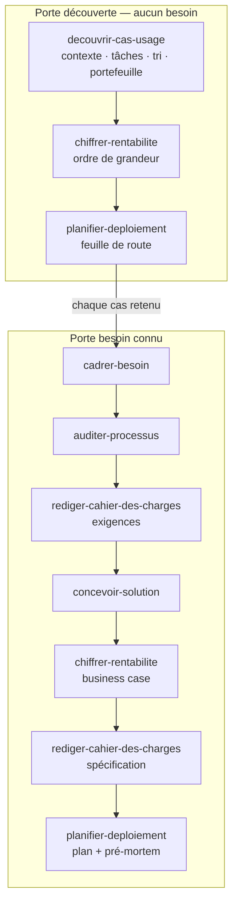

# consultant-ia

**Le pack du consultant IA et automatisation** — huit compétences pour Claude Code et Cowork qui
mènent une mission de bout en bout : comprendre le travail réel, trouver ce qui mérite d'être
automatisé, comparer les solutions, chiffrer, spécifier et planifier.

---

## Le problème

Une mission « IA » part presque toujours d'une solution : « il nous faut un chatbot », « on veut un
agent ». Ou d'aucune idée précise : « l'IA, ça pourrait nous aider, mais où ? ». Dans les deux cas,
les mêmes erreurs coûtent cher :

1. **On automatise ce qu'il aurait fallu supprimer.** Une mauvaise habitude automatisée reste une
   mauvaise habitude, plus rapide et plus difficile à voir.
2. **On choisit l'outil avant le problème.** Le bon réflexe est la question « quel est le chemin le
   plus simple pour exécuter cette tâche ? », pas « comment je le fais dans tel outil ? ».
3. **On annonce des gains qu'on n'a jamais mesurés.** Un retour sur investissement sans mesure de
   départ ne se défend pas six mois plus tard.

Ce pack donne à l'IA la méthode d'un consultant : des étapes dans l'ordre, des livrables qui servent
à décider, et une discipline sur les chiffres.

## Deux portes d'entrée

| Vous… | Tapez | Le pack enchaîne |
|---|---|---|
| **avez un besoin** (« automatiser la relance des factures ») | `/mission-besoin <le besoin>` | besoin cadré → diagnostic du processus → exigences → solutions comparées → rentabilité → spécification → plan |
| **n'avez pas encore de besoin** (« où l'IA peut-elle nous aider ? ») | `/mission-decouverte` | contexte branché → cartographie des tâches → tri → portefeuille de cas d'usage → chiffrage → feuille de route |

Chaque cas retenu par la découverte repart ensuite par la porte « besoin connu ».



## Les huit compétences

| Compétence | Ce qu'elle produit |
|---|---|
| `router-mission-ia` | l'état de la mission, la porte, l'étape suivante, le journal des décisions |
| `decouvrir-cas-usage` | fiche entreprise, cartographie des tâches, tri en cinq issues, portefeuille de cas d'usage classés |
| `cadrer-besoin` | une fiche besoin courte : vrai problème, décision, périmètre, critères de succès, et le nom du dossier du cas |
| `auditer-processus` | le diagnostic du processus actuel : mesures, goulets, causes, ce qu'on simplifie d'abord |
| `rediger-cahier-des-charges` | les exigences (avant le choix) puis la spécification de la solution retenue |
| `concevoir-solution` | des options réellement différentes, y compris ne rien construire, et une recommandation |
| `chiffrer-rentabilite` | gains, coûts, maintenance, délai de retour, en trois scénarios et hypothèses visibles |
| `planifier-deploiement` | feuille de route ou plan de déploiement (simplifications, porte, pilote), adoption, mesure, pré-mortem |

## Les règles que suit chaque compétence

- **Chaque nombre porte son statut** : `[F]` fait (observé, appuyé par une pièce, ou énoncé par son
  détenteur), `[H]` hypothèse (avec le rôle qui la confirme), `[E]` estimation calculée, calcul montré.
  Les définitions sont dans [ARCHITECTURE.md](ARCHITECTURE.md). Un gain reste « estimé » tant qu'il n'est
  pas mesuré.
- **L'humain tranche à chaque étape.** Chaque livrable finit par « Décision attendue » ; la décision
  s'inscrit au journal de la mission.
- **On observe le travail, jamais les personnes.** Aucune évaluation individuelle.
- **Supprimer et simplifier avant d'automatiser ; ce qui existe déjà passe avant ce qu'on construit.**
- **Rien ne sort du dossier de mission** : le pack n'envoie rien, ne publie rien et ne modifie aucun
  outil de l'entreprise.

Tous les livrables s'écrivent dans un dossier `mission/` à la racine de votre répertoire de travail.
Le détail des contrats est dans [ARCHITECTURE.md](ARCHITECTURE.md).

## Installation

```bash
/plugin marketplace add Gremelinn0/productivity-consultant-ia
/plugin install consultant-ia
```

Puis, dans le dossier de la mission : `/mission-besoin automatiser la relance des factures impayées`
ou `/mission-decouverte`.

## Brancher le contexte

Le pack lit ce que vous lui donnez, dans cet ordre :

1. les fichiers déposés dans `mission/sources/` : procédures, exports, comptes rendus, et surtout la
   transcription d'une séance où quelqu'un fait la tâche en partage d'écran ;
2. les outils déjà connectés à votre session (documents, messagerie, CRM…), en lecture seule et
   source par source, avec votre accord ;
3. les entretiens : il prépare les guides, vous répondez ou vous menez l'entretien.

Ce qui manque est écrit comme manquant, jamais supposé.

## Portabilité

| Élément | Statut |
|---|---|
| Système d'exploitation | indifférent |
| Hôte | Claude Code ou Cowork |
| Outils de l'entreprise | aucun requis ; les connecteurs présents dans la session sont lus en lecture seule |
| Langue | français |
| Dépendances | aucune |

## Ce que le pack ne fait pas

- Construire l'automatisation ou l'agent : la spécification et le plan sont les entrées de l'équipe
  qui construit.
- Mesurer le gain réel : il définit la mesure de départ et le protocole, l'entreprise mesure.
- Remplacer les entretiens ni décider à la place du client.

## Ce qui reste imparfait

- Éprouvé sur une mission fictive complète (voir `examples/`, déroulée le 12 octobre 2026), qui a relevé
  94 frictions, corrigées dans cette version ; pas encore sur une mission réelle.
- Les étapes construire, tester, déployer et mesurer après déploiement ne sont pas dans le pack : elles
  viendront dans une version suivante. Il s'arrête à la spécification et au plan.
- Le chiffrage ne vaut que par ses mesures d'entrée : sans temps mesurés, il reste une fourchette.
- La découverte dépend de ce que l'entreprise branche et des entretiens.
- L'adoption par les équipes tient dans le plan, pas dans une méthode dédiée.
- La recherche de l'existant (pages des éditeurs, modèles publics) suppose un accès au moment du choix ;
  sans accès, elle s'écrit « non vérifiée » et le pack le dit.

## Sources et crédits

Le pack est écrit avec ses propres mots ; il s'appuie sur des méthodes ouvertes, créditées dans
chaque compétence qui s'en sert :

- [automation-strategy](https://github.com/ericrisco/rsc-harness/tree/main/skills/automation-strategy)
  d'Eric Risco (MIT) — décider s'il faut automatiser, coût complet avec maintenance, choix de
  plateforme selon l'unité facturée ;
- [management-consulting](https://github.com/gcamilo/management-consulting) de gcamilo (MIT) —
  fourchettes bas, central et haut, sensibilité, normes de preuve ;
- [knowledge-work-plugins](https://github.com/anthropics/knowledge-work-plugins) d'Anthropic
  (Apache-2.0) — description et optimisation de processus (`process-doc`,
  `process-optimization`), spécification (`write-spec`), comparaison de solutions
  (`vendor-review`), forme de l'entretien (`smb-onboard`) ;
- [router-consulting-strategy](https://github.com/Gremelinn0/claude-skill-hub) — options réelles,
  contre-cas, recommandation d'abord.

Si ces outils sont installés dans votre session, les compétences peuvent s'en servir pour aller plus
loin ; elles ne disent les avoir utilisés que lorsqu'elles les ont réellement appelés.

## Licence

MIT — voir [LICENSE](LICENSE).
