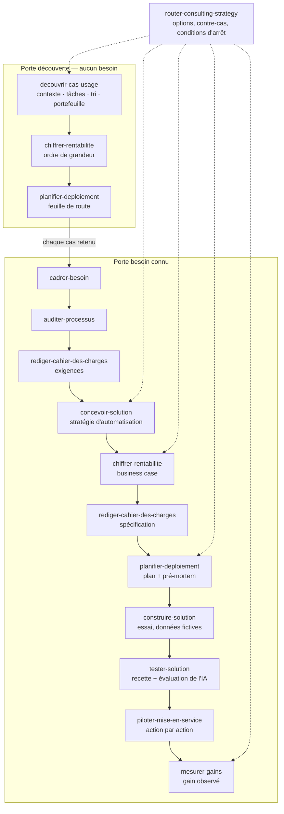

# consultant-ia

**Le pack du consultant IA et automatisation, de l'idée à la solution mesurée** — douze compétences
(plus un routeur de stratégie embarqué) pour Claude Code et Cowork qui mènent une mission de bout en
bout : comprendre le travail réel, trouver ce qui mérite d'être automatisé, comparer les solutions,
chiffrer, spécifier et planifier, puis construire et tester dans un environnement d'essai, mettre en
service action par action et mesurer ce que la solution rapporte vraiment.

---

## Le problème

Une mission « IA » part presque toujours d'une solution : « il nous faut un chatbot », « on veut un
agent ». Ou d'aucune idée précise : « l'IA, ça pourrait nous aider, mais où ? ». Dans les deux cas,
les mêmes erreurs coûtent cher :

1. **On automatise ce qu'il aurait fallu supprimer.** Une mauvaise habitude automatisée reste une
   mauvaise habitude, plus rapide et plus difficile à voir.
2. **On choisit l'outil avant le problème.** Le bon réflexe est la question « quel est le chemin le
   plus simple pour exécuter cette tâche ? », pas « comment je le fais dans tel outil ? ».
3. **On annonce des gains qu'on n'a jamais mesurés.** Un retour sur investissement sans mesure de
   départ ne se défend pas six mois plus tard, et les traces d'un outil (« 3 000 exécutions
   réussies ») ne disent pas ce qu'il rapporte.
4. **On touche un outil réel sans savoir comment revenir en arrière.** Une action faite sans
   validation précise, ou une bascule sans retour arrière, se paie le jour de l'incident.

Ce pack donne à l'IA la méthode d'un consultant : des étapes dans l'ordre, des livrables qui servent
à décider, et une discipline sur les chiffres comme sur les actions.

## Deux portes d'entrée

| Vous… | Tapez | Le pack enchaîne |
|---|---|---|
| **avez un besoin** (« automatiser la relance des factures ») | `/mission-besoin <le besoin>` | besoin cadré → diagnostic du processus → exigences → solutions comparées → rentabilité → spécification → plan → construction en essai → recette → mise en service → mesure |
| **n'avez pas encore de besoin** (« où l'IA peut-elle nous aider ? ») | `/mission-decouverte` | contexte branché → cartographie des tâches → tri → portefeuille de cas d'usage → chiffrage → feuille de route |

Chaque cas retenu par la découverte repart ensuite par la porte « besoin connu ».



## Les douze compétences

| Compétence | Ce qu'elle produit |
|---|---|
| `router-mission-ia` | l'état de la mission, la porte, l'étape suivante, le journal des décisions |
| `decouvrir-cas-usage` | fiche entreprise, cartographie des tâches, tri en cinq issues, portefeuille de cas d'usage classés |
| `cadrer-besoin` | une fiche besoin courte : vrai problème, décision, périmètre, critères de succès, et le nom du dossier du cas |
| `auditer-processus` | le diagnostic du processus actuel : mesures, goulets, causes, ce qu'on simplifie d'abord |
| `rediger-cahier-des-charges` | les exigences (avant le choix) puis la spécification de la solution retenue |
| `concevoir-solution` | la stratégie d'automatisation (faire ou non, quel type de solution, quelle plateforme), des options réellement différentes, y compris ne rien construire, et une recommandation |
| `chiffrer-rentabilite` | gains, coûts, maintenance, délai de retour, en trois scénarios et hypothèses visibles |
| `planifier-deploiement` | feuille de route (avec son socle commun) ou plan de déploiement : simplifications, porte, pilote, adoption, mesure, pré-mortem |
| `construire-solution` | la solution construite par tranches dans un environnement d'essai, sur des données fictives ou anonymisées, en version gelée, avec sa fiche d'exploitation |
| `tester-solution` | la recette critère par critère, l'évaluation de l'IA à part, les défauts et un verdict : prêt, prêt avec réserves, pas prêt |
| `piloter-mise-en-service` | chaque action sur un outil réel proposée avec son retour arrière, le pilote, la bascule, l'adoption, le transfert à un exploitant |
| `mesurer-gains` | la lecture des relevés réels, le gain observé, les coûts réels, et la décision : continuer, corriger, étendre ou arrêter |

Le dossier `skills/` embarque aussi `router-consulting-strategy`, le cerveau des décisions : les étapes qui
décident (portefeuille, choix de l'option, recommandation, priorités, continuer ou arrêter) l'appellent
pour arbitrer, et gardent leur propre livrable.

## Les règles que suit chaque compétence

- **Chaque nombre porte son statut** : `[F]` fait (observé, appuyé par une pièce, ou énoncé par son
  détenteur), `[H]` hypothèse (avec le rôle qui la confirme), `[E]` estimation calculée, calcul montré.
  Les définitions sont dans [ARCHITECTURE.md](ARCHITECTURE.md). Un gain reste « estimé » tant qu'il n'est
  pas mesuré, et seule l'étape de mesure le déclare observé.
- **L'humain tranche à chaque étape.** Chaque livrable finit par « Décision attendue » ; la décision
  s'inscrit au journal de la mission.
- **On observe le travail, jamais les personnes.** Aucune évaluation individuelle.
- **Supprimer et simplifier avant d'automatiser ; ce qui existe déjà passe avant ce qu'on construit.**
- **Rien ne touche un outil réel sans la validation de l'action précise** : le pack construit et teste
  dans un environnement d'essai, sur des données fictives ou anonymisées ; chaque action sur un outil de
  l'entreprise est proposée avec son retour arrière et ne se fait qu'après la validation du client
  (règle 7 d'[ARCHITECTURE.md](ARCHITECTURE.md)).

Tous les livrables s'écrivent dans un dossier `mission/` à la racine de votre répertoire de travail.
Le détail des contrats est dans [ARCHITECTURE.md](ARCHITECTURE.md).

## Les compagnons

[COMPAGNONS.md](COMPAGNONS.md) cite les compétences d'autres auteurs qui vont plus loin sur une
plateforme ou un outil précis (flux n8n ou Make, agent codé, évaluation de l'IA, mise en service,
mesure), avec leur licence et la condition où les appeler. Elles ne sont jamais copiées dans le pack, et
une étape ne dit s'en être servie que si elle les a réellement appelées. Sans compagnon installé, chaque
étape suit sa méthode maison.

## Installation

```bash
/plugin marketplace add Gremelinn0/productivity-consultant-ia
/plugin install consultant-ia
```

Si la première commande répond « SSH authentication failed » (aucune clé SSH GitHub sur la machine),
donnez l'adresse complète :

```bash
/plugin marketplace add https://github.com/Gremelinn0/productivity-consultant-ia.git
/plugin install consultant-ia
```

Puis, dans le dossier de la mission : `/mission-besoin automatiser la relance des factures impayées`
ou `/mission-decouverte`.

## Brancher le contexte

Le pack lit ce que vous lui donnez, dans cet ordre :

1. les fichiers déposés dans `mission/sources/` : procédures, exports, comptes rendus, et surtout la
   transcription d'une séance où quelqu'un fait la tâche en partage d'écran ; après la mise en service,
   les relevés de mesure que vous y déposez ;
2. les outils déjà connectés à votre session (documents, messagerie, CRM…), en lecture seule et
   source par source, avec votre accord ;
3. les entretiens : il prépare les guides, vous répondez ou vous menez l'entretien.

Ce qui manque est écrit comme manquant, jamais supposé.

## Portabilité

| Élément | Statut |
|---|---|
| Système d'exploitation | indifférent |
| Hôte | Claude Code ou Cowork |
| Outils de l'entreprise | aucun requis ; les connecteurs présents dans la session sont lus en lecture seule, et toute action sur un outil réel est proposée, jamais faite sans votre validation |
| Langue | français |
| Dépendances | aucune (les compagnons de `COMPAGNONS.md` sont facultatifs) |

## Ce que le pack ne fait pas

- Toucher un outil réel sans la validation de l'action précise : il construit et teste en environnement
  d'essai, et les actions sur vos outils (importer, écrire, envoyer, publier) sont les vôtres, une à une.
- Remplacer les entretiens ni décider à la place du client.
- Relever à votre place : la mesure se lit sur les relevés que vous fournissez.

## Ce qui reste imparfait

- Pas encore éprouvé sur une mission réelle. La mission fictive (voir `examples/`) a éprouvé les étapes
  de décision et relevé 94 frictions, corrigées. Elle a ensuite été prolongée jusqu'à la mesure : la
  construction et la recette y sont réelles (une maquette exécutable, 43 tests, 17 sabotages), la mise
  en service et la mesure sont simulées (décisions et relevés inventés, calculs réels). Aucune
  plateforme n'a été touchée, et le constructeur y est aussi le testeur.
- Un seul essai comparé, qui ne démontre pas d'avantage. Le 13/10/2026, la même mission fictive a été
  menée par une session avec le pack et par une session sans ; un autre modèle les a notées à l'aveugle sur
  15 points, avec une grille écrite avant l'essai : 14 contre 12. L'écart est sous le seuil de 3 points
  fixé d'avance. L'aveugle était imparfait : les livrables du pack se nommaient eux-mêmes.
- Dans une session chargée de nombreuses compétences, une demande peut partir vers une autre compétence :
  commencez une mission par `/mission-besoin` ou `/mission-decouverte` (essai dans
  [COMPAGNONS.md](COMPAGNONS.md)).
- Les compagnons sont lus, pas essayés.
- Le chiffrage ne vaut que par ses mesures d'entrée, et la mesure par les relevés que vous fournissez :
  sans relevé, aucun gain n'est un fait.
- La découverte dépend de ce que l'entreprise branche et des entretiens.
- Ce que l'hôte ne permet pas d'exécuter reste « prévu » : la version ne peut alors pas être déclarée
  prête pour la recette.
- L'adoption par les équipes se prépare par rôle (formation, approbations, communication), sans programme
  complet de conduite du changement.
- La recherche de l'existant (pages des éditeurs, modèles publics) suppose un accès au moment du choix ;
  sans accès, elle s'écrit « non vérifiée » et le pack le dit.
- En français seulement.

## Sources et crédits

Le pack est écrit avec ses propres mots ; il s'appuie sur des méthodes ouvertes. Les compétences d'autres
auteurs qui vont avec lui sont créditées, avec leur licence, dans [COMPAGNONS.md](COMPAGNONS.md). Les
méthodes dont il s'inspire sont :

- [automation-strategy](https://github.com/ericrisco/rsc-harness/tree/main/skills/automation-strategy)
  d'Eric Risco (MIT) — décider s'il faut automatiser, piège du processus cassé, test de stabilité et
  garde-fou humain, coût complet avec ligne de maintenance et repères de retour, unités de facturation et
  choix de plateforme, garanties d'exécution (dédoublonnage, erreurs et file des échecs, secrets,
  observabilité, environnements), propriétaire nommé, interrupteur, alerte sur le silence, comptes non
  personnels ;
- [management-consulting](https://github.com/gcamilo/management-consulting) de gcamilo (MIT) —
  fourchettes bas, central et haut, sensibilité, normes de preuve, écriture individuelle avant partage et
  relance aux jalons du pré-mortem ;
- [knowledge-work-plugins](https://github.com/anthropics/knowledge-work-plugins) d'Anthropic
  (Apache-2.0) — description et optimisation de processus (`process-doc`, `process-optimization`),
  structure d'une spécification, priorisation et critères d'acceptation (`write-spec`), comparaison de
  solutions (`vendor-review`), retour arrière, communication et mode opératoire d'exploitation
  (`change-request`, `runbook`), forme de l'entretien (`smb-onboard`) ;
- [router-consulting-strategy](https://github.com/Gremelinn0/claude-skill-hub) — options réelles,
  contre-cas, recommandation d'abord (embarqué dans ce pack) ;
- « Performing a Project Premortem » de Gary Klein (Harvard Business Review, 2007) — le pré-mortem.

Si ces outils sont installés dans votre session, les compétences peuvent s'en servir pour aller plus
loin ; elles ne disent les avoir utilisés que lorsqu'elles les ont réellement appelés.

## Licence

MIT — voir [LICENSE](LICENSE).
