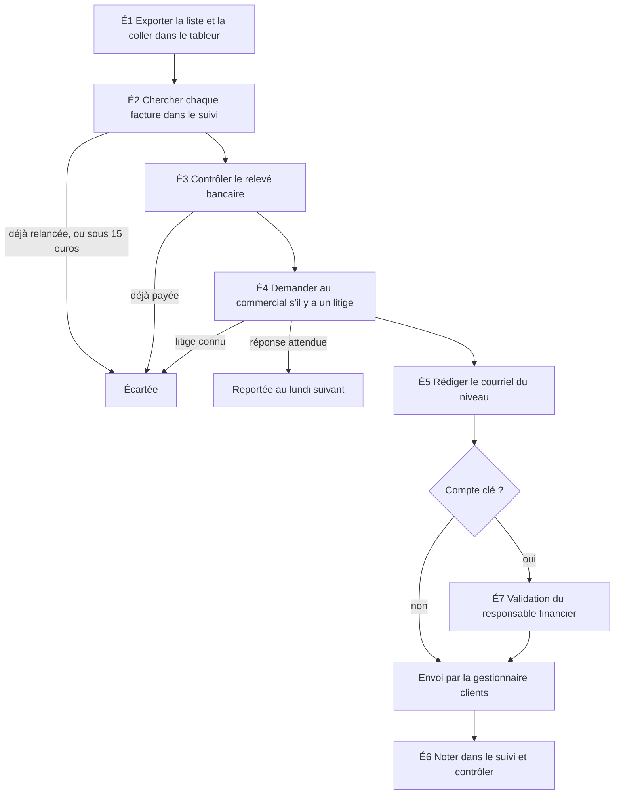

# Diagnostic — Relances de factures échues

2026-09-30 · Demandeur : direction générale · Valideur : responsable financier · Rédigé par : consultant IA · Source de la description : observation (séance du lundi 2026-09-07, une occurrence de 156 min), complétée par l'entretien finance du 2026-09-02 ; la procédure écrite n'est pas reçue à ce jour · Relue par : la gestionnaire clients, qui fait le travail, puis le responsable financier, le 2026-09-29 (relecture simulée) ; ils s'y reconnaissent
Version 1.1, précisée le 2026-10-15 : la rubrique 7 porte le mode opératoire du processus cible (la procédure du métier, une page) et la dernière colonne de la rubrique 1 dit aussi les variantes connues. Aucune mesure, aucun tri et aucune opportunité ne change.

## 1. Le processus tel qu'il se fait

| Étape | Rôle | Outil | Entrées | Sorties | Passage de main ou attente | Décision, exception ou variante |
|---|---|---|---|---|---|---|
| É1 Exporter les factures échues et les coller dans le tableur | gestionnaire clients | logiciel de facturation ; tableur partagé, onglet « échues » | factures échues | liste filtrée sur l'âge : factures à J+7, J+21 ou J+35 | aucun ; l'onglet est recollé en entier chaque semaine | le filtre sur l'âge désigne les factures à traiter |
| É2 Chercher chaque facture dans « suivi » | gestionnaire clients | tableur, onglet « suivi » | numéro de facture | « déjà relancée à ce niveau » ou « à traiter » | aucun | double évité ; montant sous 15 € `[F]` laissé de côté, règle personnelle non écrite |
| É3 Contrôler les paiements sur le relevé bancaire | gestionnaire clients | relevé bancaire ; tableur | montants des factures ; relevé du jour | factures « déjà payées » écartées | attente du lettrage : les paiements du vendredi et du lundi matin ne sont pas rapprochés | facture payée : écartée |
| É4 Demander aux commerciaux s'il y a un litige | gestionnaire clients ; commercial | messagerie ; notes personnelles | clients à vérifier | « litige » ou « pas de litige » | attente de la réponse du commercial ; aucun accès à l'outil du support | litige connu : écartée ; réponse attendue : reportée au lundi suivant |
| É5 Rédiger et envoyer les courriels | gestionnaire clients | messagerie (boîte partagée de la finance) ; document de trois modèles | factures restantes ; modèle du niveau | relances envoyées | les comptes clés passent au responsable financier avant envoi | modèle courtois au niveau 1, ferme au niveau 3 ; compte clé : préparé, non envoyé ; variante : la suppléante relance parfois dès J+3 et prend le modèle ferme d'emblée `[H]` (gestionnaire clients), et la comptable a relancé une facture un vendredi, hors du rythme du lundi `[F]` |
| É6 Noter les relances dans « suivi » et contrôler | gestionnaire clients | tableur, onglet « suivi » | relances envoyées | suivi à jour : date, niveau, facture | aucun | noté à la fin, pour tout reprendre d'un coup |
| É7 Valider les relances des comptes clés | responsable financier | messagerie | brouillons des comptes clés | envoi, ou correction | passage de main depuis la gestionnaire clients ; délai non observé | liste des comptes clés non écrite, environ 25 comptes `[H]` |
| É8 Téléphoner, puis envoyer un courrier recommandé au-delà de J+60 `[H]` | responsable financier | téléphone ; courrier recommandé | factures au-delà de J+60 | — | non observé | hors périmètre du cas (`10-besoin.md`) |

Source. Observation : la gestionnaire clients a été enregistrée pendant une séance réelle du lundi, le consultant observant sans intervenir (accords de la direction générale, du responsable financier et de la gestionnaire clients, recueillis le 2026-08-31). Entretien : le responsable financier et la gestionnaire clients complètent É7 et É8, que la séance n'a pas montrés. Non observés : la validation des comptes clés, les relances au-delà de J+60, une séance tenue par la comptable, la semaine de fin de mois.

## 2. Mesures

| Mesure | Valeur | Statut | Source, ou comment la mesurer |
|---|---|---|---|
| Volume : relances envoyées | 96 par mois (niveau 1 : 58 ; niveau 2 : 28 ; niveau 3 : 10) | `[F]` | export de facturation, moyenne de mai à juillet 2026 |
| Volume : stock de factures échues au 2026-08-28 | 210 factures, 118 500 € HT | `[F]` | export de facturation |
| Dont retards de plus de 35 jours | 33 factures, 30 900 € HT | `[E]` | 22 + 11 factures ; 20 100 + 10 800 € HT (export de facturation) |
| Fréquence | une séance chaque lundi, soit 4 par mois | `[E]` | 96 relances par mois ÷ 24 relances à la séance ; convention de `01` |
| Factures à traiter à la séance | 61 | `[F]` | séance du 2026-09-07, une seule occurrence |
| Durée de la séance | 156 min | `[F]` | horodatage de la séance, une seule occurrence |
| Durée déclarée de la séance | environ 3 h | `[H]` | gestionnaire clients ; on retient l'observation (l'écart est traité dans `01`) |
| Temps par étape, séance du 2026-09-07 | É1 12 min · É2 35 min · É3 32 min · É4 9 min · É5 52 min · É6 16 min, soit 156 min | `[F]` | horodatage de la séance, une seule occurrence |
| Temps par étape, durées typiques | les mêmes six durées | `[H]` | à confirmer sur trois lundis chronométrés (gestionnaire clients) |
| Temps de travail effectif par relance envoyée | 6,5 min | `[H]` | 156 min ÷ 24 relances ; une seule occurrence : durée typique à confirmer par la gestionnaire clients |
| Temps de travail effectif par facture traitée | 2,6 min | `[E]` | 156 min ÷ 61 factures |
| Part du contrôle manuel (É2 + É3 + É4) | 76 min, soit 49 % de la séance | `[E]` | 35 + 32 + 9 min ; 76 ÷ 156 |
| Coût mensuel de la séance | 10,4 h, soit 322 € | `[E]` | 4 séances × 2,6 h × 31 € (coût horaire chargé de la gestionnaire clients `[F]`, entretien finance) |
| Issue des 61 factures | 24 relances envoyées (niveau 1 : 14 ; niveau 2 : 7 ; niveau 3 : 3) ; 37 non relancées : 9 déjà payées, 4 déjà relancées, 6 en litige connu, 5 comptes clés à valider, 7 en attente du commercial, 6 sous 15 € | `[F]` | décompte de la séance, un motif noté par facture |
| Taux de reprise : factures reportées au lundi suivant | 12 sur 61, soit 20 % | `[E]` | 7 en attente du commercial + 5 comptes clés ; 12 ÷ 61 |
| Réclamations après relance | 13 par mois | `[F]` | export des tickets, moyenne de mai à juillet 2026 |
| Taux de réclamation | 13,5 % des relances | `[E]` | 13 ÷ 96 ; toutes les réclamations ne viennent pas d'une relance à tort : à classer par motif |
| Attente : lettrage | 4 jours entre le lettrage du jeudi et la séance du lundi | `[E]` | jeudi → lundi ; dernier lettrage le 2026-08-27, un jeudi `[F]` (export de facturation) |
| Attente : réponse du commercial | 7 jours au moins pour 7 factures ; aucune réponse à 11:38 | `[F]` | séance (reprise « lundi prochain ») |
| Délai entre le seuil franchi et l'envoi | 3 jours en moyenne | `[E]` | rythme hebdomadaire : 0 à 6 jours, franchissements supposés répartis sur la semaine ; à mesurer : date d'envoi moins date du seuil, dans « suivi », sur trois mois |

Lecture. Le délai d'une relance est fait d'attente, pas de travail : 3 jours en moyenne avant la séance, 7 de plus si le commercial n'a pas répondu. Accélérer le travail de la séance ne raccourcit pas ce délai. Les 24 relances envoyées sont les cas simples ; les 37 autres sont des cas complexes, et la moyenne de 6,5 min par relance les cache (2,6 min par facture traitée).

À mesurer encore : la durée par type de cas (niveau 1, 2, 3, compte clé, litige) ; une séance de la comptable ; la semaine de fin de mois ; le motif des 13 réclamations ; le délai de validation des comptes clés. Moyen : chronométrer trois lundis consécutifs avec un horodatage par facture (gestionnaire clients) ; classer les 13 réclamations d'un mois par motif (responsable du support) ; relever le délai de validation dans la messagerie (responsable financier).
Statuts : ceux d'`ARCHITECTURE.md`. Une durée chronométrée sur une seule occurrence est `[F]` pour cette occurrence et `[H]` comme durée typique.

## 3. Goulets et gaspillages

| Étape | Nature (ressaisie, attente, double contrôle…) | Effet | Coût `[E]` |
|---|---|---|---|
| É1 | ressaisie : l'export est recollé en entier chaque semaine | 12 min par séance `[F]` ; l'onglet ne se met jamais à jour seul | 25 € par mois ; 8 % de la séance |
| É2 | recherche d'information : chaque facture est cherchée une à une dans « suivi » | 35 min par séance `[F]` ; 4 doubles évités sur 61 `[F]` grâce à cette recherche ; un cas vu de relance notée sur une mauvaise ligne | 72 € par mois ; 22 % |
| É3 | double contrôle : le relevé revérifie ce que le lettrage du jeudi établit déjà ; attente du lettrage | 32 min par séance `[F]` ; 9 factures sur 61 déjà payées `[F]`, relancées à tort sans ce contrôle | 66 € par mois ; 21 % |
| É4 | attente et information invisible : la finance ne voit pas les litiges du support | 9 min par séance `[F]` ; 7 factures reportées d'une semaine `[F]` | 19 € par mois ; 6 % ; le retard des 7 factures n'est pas converti en euros |
| É5 | ressaisie : le modèle est copié, puis numéro, montant et échéance changés à la main | 52 min par séance `[F]`, soit 2,2 min par courriel `[E]` ; un numéro oublié une fois, le client a rappelé `[H]` (gestionnaire clients) | 107 € par mois ; 33 % |
| É6 | ressaisie : chaque relance est notée à la main, à la fin | 16 min par séance `[F]` ; ce suivi sert à la recherche de É2 la semaine suivante | 33 € par mois ; 10 % |
| É7 | attente de validation ; règle non écrite (liste des comptes clés) | 5 factures en attente à la séance `[F]` ; délai non observé | non mesuré |
| Toutes | exceptions traitées au cas par cas | 6 factures sur 61 écartées par un seuil de 15 € que personne n'a demandé `[F]` ; 14 factures sous 15 € dans le stock du 2026-08-28 `[F]` | non chiffré |
| Aval | reprise : traitement des réclamations après relance, côté support | 13 réclamations par mois `[F]`, 14 min chacune `[H]` | au plus 88 € par mois (13 × 14 min × 29 €) ; part due à une relance à tort non mesurée |

Les six étapes observées coûtent 322 € par mois. Le contrôle manuel (É2, É3, É4) en pèse 157 €, soit 49 %.

## 4. Causes

| Goulet | Pourquoi (la chaîne) | Cause actionnable | Nature : processus, organisation, donnée ou outil |
|---|---|---|---|
| É3 Contrôle du relevé | le relevé est contrôlé à la main → le logiciel ne connaît pas encore les paiements du week-end ni du lundi → le lettrage a lieu le jeudi, la séance le lundi → rien n'impose l'ordre des deux tâches (la raison du jeudi n'est pas connue ; la comptable peut la dire) | lettrer avant de relancer | processus |
| É4 Messages aux commerciaux | une question est posée pour chaque client douteux → la finance ne sait pas s'il y a un litige → l'étiquette « litige » est posée dans l'outil de tickets, que la finance ne voit pas (17 tickets étiquetés au 2026-08-28 `[F]`) → personne n'est chargé de partager cette information | une liste de litiges partagée avec la finance, tenue par le support | organisation |
| É2 Recherche dans « suivi » | chaque facture est cherchée à la main → l'historique tient en une ligne par relance, notée à la fin, sans format imposé → une ligne mal placée n'est plus retrouvée que par la recherche | un format imposé pour le suivi | donnée |
| É1 Collage | l'export est recollé en entier → l'onglet « échues » n'est pas relié au logiciel de facturation → rien n'actualise l'onglet | actualiser l'onglet depuis le logiciel | outil |
| É5 Rédaction | chaque courriel est composé à la main → le modèle est un texte libre → le numéro, le montant et l'échéance ne sont pas repris de l'export | des modèles dont les champs viennent de l'export | outil |
| É6 Journalisation | les relances sont notées à la fin → l'envoi se fait dans la messagerie, le suivi dans le tableur → rien ne relie l'un à l'autre | que l'envoi écrive dans le suivi | outil |
| É7 Validation des comptes clés | la validation attend le responsable financier → la liste des comptes clés n'est pas écrite → personne ne l'a en charge | une liste écrite, avec un propriétaire | organisation |
| Exceptions | le seuil de 15 € est appliqué `[F]` alors que le responsable financier dit « pas de seuil » `[H]` ; la suppléante relance dès J+3 `[H]` → la procédure écrite n'est pas reçue → personne n'a tranché entre la règle annoncée et les pratiques | une procédure unique, écrite et validée | processus |

Les 13 réclamations par mois ne sont pas une étape : elles viennent des causes de É3, É4 et É2 (paiement non rapproché, litige non vu, double). L'essai de 2024 a probablement la même origine `[H]` (le responsable financier peut le confirmer).

## 5. Stabilité

| Question | Réponse | Source |
|---|---|---|
| Le processus se fait-il pareil à chaque fois ? | Oui pour la trame : mêmes étapes, même ordre chaque lundi `[H]` (gestionnaire clients). Non vérifié : une seule séance observée. Le volume mensuel varie peu : 92, 99 et 97 relances `[F]`. | séance du 2026-09-07 ; entretien finance ; export de facturation |
| Les règles de décision sont-elles écrites ? | Non. Les délais J+7, J+21 et J+35 sont annoncés `[H]` (responsable financier) et appliqués à la séance `[F]` ; leur procédure n'est pas reçue. Trois règles ne sont écrites nulle part : le seuil de montant (15 € observé, « pas de seuil » déclaré), les comptes clés (liste « dans ma tête et dans un vieux courriel »), les litiges (notes personnelles) `[F]`. | séance ; entretien finance |
| Deux personnes ou plus le font-elles de la même façon ? | Non, d'après les déclarations. La suppléante relance parfois dès J+3 et prend le modèle ferme d'emblée `[H]` (gestionnaire clients) ; le responsable financier dit « la même procédure pour tout le monde » `[H]`. La comptable a relancé une facture un vendredi, hors du rythme du lundi `[F]`. La comptable, qui remplace la gestionnaire clients, est non observée : une séance tenue par elle n'a pas été vue. | entretien finance ; séance (09:26) |
| Les étapes, les outils ou les règles vont-ils changer bientôt ? | Oui, par ce chantier : le lettrage change de jour, la colonne « litige » et les trois règles seront écrites `[H]`. Hors chantier : la décision de renouvellement du logiciel de facturation tombe en mars 2027 `[F]`. | `04-feuille-de-route.md`, section 3 ; entretien direction |

Verdict : à standardiser d'abord. Les réponses 2 et 3 sont négatives : le tri ne conclut à aucune automatisation tant que la procédure unique n'est pas écrite, testée à la main sur trois lundis et re-mesurée.

## 6. Tri des étapes

| Étape | Issue | Pourquoi | Garde-fou ou validation humaine |
|---|---|---|---|
| É1 Exporter et coller | Simplifier d'abord | étape mécanique qui serait « Automatiser » ; le verdict « à standardiser d'abord » l'interdit ; issue visée après la re-mesure : Automatiser | aucun envoi en jeu (lecture seule) |
| É2 Chercher dans « suivi » | Simplifier d'abord | mécanique, mais l'historique n'a pas de format imposé (cause de É2) : le structurer d'abord ; issue visée après la re-mesure : Automatiser | la gestionnaire clients contrôle les doubles |
| É3 Contrôler le relevé | Éliminer (réduire) | contrôle d'un fait que le lettrage établit déjà ; la cause est l'ordre des deux tâches | un contrôle par exception des paiements du jour peut subsister `[H]` |
| É4 Demander aux commerciaux | Éliminer | remplacé par la colonne « litige » partagée ; une question ne reste que pour un litige absent de la colonne | le support alimente la colonne chaque jour ; un litige non saisi est signalé |
| É5 Rédiger et envoyer | Simplifier d'abord | trois modèles, trois champs, mais des règles de niveau et de montant non écrites et deux façons de faire ; issue visée après la re-mesure : Déléguer à l'IA (la préparation peut être déléguée, l'envoi est un acte vers l'extérieur) | validation humaine de chaque envoi `[F]` (règle de la direction) ; comptes clés validés par le responsable financier |
| É6 Noter et contrôler | Simplifier d'abord | mécanique ; dépend du format du suivi et de l'envoi ; issue visée après la re-mesure : Automatiser | contrôle final par la gestionnaire clients |
| É7 Valider les comptes clés | Garder | décision et relation : un compte clé figure parmi les plaintes de 2024 `[H]` | le responsable financier valide chaque relance d'un compte clé |
| É8 Téléphone et recommandé | hors périmètre | négociation et relation ; hors périmètre du cas (`10-besoin.md` §6), sans issue | décision du responsable financier |

## 7. À simplifier et à standardiser d'abord

1. **Supprimer le contrôle du relevé : lettrer avant la séance du lundi.** Le jour et l'heure exacts se fixent en conception. Effet attendu `[E]` : jusqu'à 32 min par séance, soit 2,13 h et 66 € par mois (plafond : le contrôle disparaît tout à fait). Mesure : factures « déjà payées » trouvées à la séance (9 sur 61 au départ `[F]`) et durée de É3 (32 min au départ `[F]`). Échéance proposée `[H]` : lundi 2026-10-05.
2. **Supprimer les messages aux commerciaux : une colonne « litige » partagée**, alimentée chaque jour par le support. Effet attendu `[E]` : jusqu'à 9 min par séance, soit 0,6 h et 19 € par mois ; les 7 factures en attente ne sont plus reportées d'une semaine. Mesure : factures en attente du commercial (7 au départ `[F]`) et durée de É4 (9 min au départ `[F]`). Échéance `[H]` : 2026-10-05, après confirmation écrite du responsable du support.
3. **Écrire la procédure unique** : délais J+7, J+21 et J+35 pour tous, suppléante comprise ; seuil de montant ; règle des litiges ; un modèle par niveau. La tester à la main sur trois lundis. Effet attendu : pas de gain de temps direct ; l'écart de la suppléante (J+3 contre J+7 `[H]`) disparaît ; condition de toute automatisation. Mesure : sur dix factures prises au hasard, la gestionnaire clients et la comptable prennent les mêmes décisions (dix sur dix, cible `[H]`) ; règles non écrites : 3 au départ `[F]`, 0 à l'arrivée. Échéance `[H]` : 2026-10-09.
4. **Écrire la liste des comptes clés et nommer son propriétaire** (le responsable financier). Effet attendu : pas de gain de temps direct ; la validation ne dépend plus de la mémoire. Mesure : comptes clés rencontrés à une séance et absents de la liste (0 attendu `[H]`). Échéance `[H]` : 2026-10-09.
5. **Standardiser le suivi** : une ligne par facture, avec le niveau et la date de chaque relance en colonnes. La structure exacte se fixe avec la gestionnaire clients. Effet attendu `[E]` : au plus 35 min par séance, soit 72 € par mois ; la part réelle reste à mesurer. Mesure : durée de É2 sur trois lundis (35 min au départ `[F]`). Échéance `[H]` : 2026-10-09.

L'ordre suit les dépendances : 1 et 2 retirent du temps sans rien écrire de nouveau ; 3 et 4 fixent les règles dont 5 dépend, puisque le suivi enregistre ce que les règles décident. Les échéances reprennent `04-feuille-de-route.md`, section 3 ; le point 5 s'y ajoute. Ensuite, avant d'automatiser : appliquer ces cinq points pendant trois lundis, re-mesurer (durée par étape, factures déjà payées, réclamations), puis refaire le tri de la rubrique 6. Le plan de ces simplifications (qui fait quoi, quand) appartient à `planifier-deploiement` : il figure en vague 0 de `04-feuille-de-route.md` et au lot 1 de `70-plan.md`.

Mode opératoire du processus cible. C'est la procédure du métier, celle de la « procédure unique » du point 3, que la gestionnaire clients ou la comptable suit sans la lire deux fois ; la fiche d'exploitation du dispositif s'écrit plus tard, en `80-construction`. Elle s'applique dès que les cinq points sont en place et reste le repli (option 0).

| Étape cible | Rôle | Exceptions et conduite à tenir | Variantes (gardée · supprimée, pourquoi) | Indicateur de suivi |
|---|---|---|---|---|
| 1 Rapprocher les paiements avant la séance (jour et heure à fixer, Q-06) | comptable | un paiement arrivé après le rapprochement reste invisible : la facture reste relançable ; si le dernier rapprochement date de plus d'un jour ouvré, aucune relance n'est préparée et la gestionnaire clients le demande à la comptable | supprimée : le contrôle du relevé bancaire à la séance (É3) ; gardée : un contrôle par exception des paiements du jour `[H]` | factures « déjà payées » trouvées à la séance : 9 sur 61 au départ `[F]` |
| 2 Signaler les litiges dans la colonne partagée, chaque jour ouvré | support | un litige découvert par la finance et absent de la colonne : la finance prévient le support, la facture sort de la séance | supprimée : les messages aux commerciaux (É4), sauf pour un litige absent de la colonne | factures en attente d'un commercial : 7 sur 61 au départ `[F]` |
| 3 Établir la liste du lundi : les factures qui ont atteint J+7, J+21 ou J+35 sans relance consignée à ce niveau | gestionnaire clients (suppléante : comptable) | une facture écartée ou reportée une semaine revient la suivante (`30-exigences.md` version 1.1) ; jamais de saut de niveau ; au-delà de J+60, la facture va au responsable financier | supprimée : la relance dès J+3 de la suppléante ; gardée : les trois délais, pour tous | règles non écrites : 3 au départ `[F]`, 0 attendu `[H]` |
| 4 Écarter les factures non justifiées, en notant le motif | gestionnaire clients | payée, déjà relancée au niveau, en litige : écartée avec son motif ; compte clé : préparé, remis au responsable financier, non envoyé ; sous le seuil de montant de la procédure unique (Q-02) : écartée | supprimée : le seuil de 15 € appliqué sans règle écrite ; gardée : un seul seuil écrit, tranché par le responsable financier | durée de É2 : 35 min par séance au départ `[F]` |
| 5 Rédiger et envoyer les courriels du niveau (trois modèles) | gestionnaire clients ; responsable financier pour un compte clé | numéro, montant et échéance repris de l'export, jamais retapés ; compte clé validé par le responsable financier sous 2 jours ouvrés `[H]`, sinon reporté à la séance suivante | supprimée : la façon propre de la suppléante (modèle ferme d'emblée) ; gardée : un modèle par niveau | durée de É5 : 52 min par séance au départ `[F]` |
| 6 Noter chaque relance dans l'historique au format fixe, au moment de l'envoi | gestionnaire clients | une ligne par facture et par niveau ; une ligne mal placée se corrige tout de suite, la relance se retrouvant dans les envoyés | supprimée : la note faite à la fin pour tout reprendre d'un coup ; gardée : le contrôle final | durée de É6 : 16 min par séance au départ `[F]` ; relance notée sur une mauvaise ligne : 1 cas vu `[F]`, 0 attendu `[H]` |

## 8. Les huit questions d'automatisation

| Question | Réponse, avec sa source | Statut |
|---|---|---|
| Quel événement déclenche le processus, et quel résultat doit-il produire ? | Déclencheur : chaque lundi, les factures qui atteignent J+7, J+21 ou J+35 après l'échéance. Résultat : un courriel par facture justifiée, validé par un humain, et un suivi à jour (`10-besoin.md`). | `[F]` |
| Quelles étapes sont stables et répétitives, lesquelles exigent une décision humaine ? | Répétitives : É1, É2, É6 et la trame de É5 (un modèle par niveau). Décision humaine : le litige (É4), le compte clé (É7), le troisième niveau, avec le responsable financier en copie, et tout ce qui dépasse J+60. Les règles ne sont stables qu'une fois écrites (rubrique 5). Source : entretien finance ; séance du 2026-09-07. | `[H]` gestionnaire clients, responsable financier |
| Quels systèmes, comptes et droits faut-il lire ou modifier ? | Lire : l'export des factures échues (logiciel de facturation), le relevé bancaire, la colonne « litige », la liste des comptes clés. Écrire : l'onglet « suivi » et les brouillons dans la boîte partagée de la finance. L'outil de tickets reste fermé à la finance, aucun connecteur n'est ouvert au consultant. Droits à ouvrir : écriture dans le tableur et la boîte partagée. Source : entretien finance ; entretien direction (« pas de connecteur ouvert »). | `[F]` outils ; `[H]` droits (responsable financier) |
| Quel volume, quelle fréquence, quel niveau de criticité ? | 96 relances par mois et 61 factures à traiter par lundi, une séance par semaine. Criticité haute : un message part chez un client, 13 réclamations par mois ; 210 factures échues pour 118 500 € HT au 2026-08-28. Source : export de facturation ; export des tickets ; séance. | `[F]` |
| Quelles erreurs sont acceptables, lesquelles doivent bloquer, et qui alerter ? | Acceptable : une relance oubliée, qui part au lundi suivant. Bloquant : une relance à un client qui a payé, en litige, à un compte clé non validé, ou deux fois au même niveau. Alerter : la gestionnaire clients ; le responsable financier pour un compte clé. Source : entretien direction ; entretien finance. | `[F]` règle de la direction (aucun envoi sans humain) ; `[H]` le reste (responsable financier) |
| Quelles données sensibles, règles de conformité ou validations humaines doivent encadrer l'IA ? | Les coordonnées des contacts sont des données personnelles à limiter ; tout reste dans l'Union européenne. Validation humaine de chaque envoi ; comptes clés validés par le responsable financier. Aucun nom de client dans les documents déposés. Source : entretien direction ; `10-besoin.md` §7. | `[F]` |
| Quel cas limite doit absolument fonctionner avant de généraliser ? | Un client qui a payé vendredi, paiement non encore rapproché, dont la facture atteint J+21 le lundi : aucune relance ne doit partir. C'est la panne de 2024. Source : entretien direction (essai de 2024). | `[H]` responsable financier |
| Qui maintiendra automatisations, prompts, modèles et accès après livraison ? | Le responsable financier pour les règles et l'administration du logiciel ; la gestionnaire clients pour les modèles de courriel et le suivi. Reste à désigner : qui maintient l'automatisation elle-même. Source : entretien finance. | `[F]` administration du logiciel ; `[H]` le reste (direction générale) |

## 9. Opportunités classées

| Opportunité | Valeur (gain mensuel `[E]`) | Facilité | Risque | Classe |
|---|---|---|---|---|
| 1. Supprimer le contrôle du relevé : lettrer avant la séance | jusqu'à 66 € (32 min × 4 séances = 2,13 h × 31 €) ; 9 factures sur 61 déjà payées `[F]` ne partent plus | haute : aucun outil ; la comptable lettre déjà chaque jeudi `[F]` | bas : un lettrage plus tôt ne change aucune écriture ; un paiement tardif reste possible | Gains rapides |
| 2. Supprimer les messages aux commerciaux : colonne « litige » partagée | jusqu'à 19 € (9 min × 4 = 0,6 h × 31 €) ; 13 factures sur 61 en litige connu ou à confirmer `[E]` (6 + 7) | haute : le responsable du support accepte d'alimenter la colonne chaque jour `[H]` ; tableur déjà partagé | bas : une colonne en retard ramène à la situation actuelle | Gains rapides |
| 3. Écrire la procédure unique et la liste des comptes clés | 0 € direct ; condition de l'opportunité 5 (172 €) | haute : les règles existent dans les têtes, elles ne sont pas écrites | bas : une règle écrite n'envoie rien ; le seuil de montant engage le responsable financier | Gains rapides (valeur indirecte : elle conditionne 5) |
| 4. Standardiser le suivi : une ligne par facture | au plus 72 € (35 min × 4 = 2,33 h × 31 €) ; part réelle inconnue | à classer : quelle structure retenir ? | moyen : l'historique existant est à migrer | À creuser : manque la structure à retenir et le temps de recherche qu'elle laisse ; la gestionnaire clients le mesure sur trois lundis |
| 5. Préparer automatiquement la liste et les brouillons, envoi validé par un humain | 172 € (83 min × 4 ÷ 60 = 5,5333 h × 31 €), après 1 et 2 ; temps résiduel supposé `[H]` | moyenne : données par export en lecture seule ; règles stables seulement après 3 | haut : un message part chez un client ; validation humaine de chaque envoi `[F]` | Projets |
| 6. Configurer le module de relances déjà présent dans le logiciel | non établie : mêmes phases que 5, au plus 172 € | à classer : le module sait-il exclure litiges, comptes clés et petits montants, et attendre une validation ? `[H]` | haut : il a écrit à des clients qui avaient payé en 2024 `[H]` | À creuser : manquent ses capacités, que lit le responsable financier dans la documentation de l'éditeur (échéance 2026-10-02 `[H]`) |
| 7. Envoyer sans validation humaine | jusqu'à 50 € (24 min × 4 = 1,6 h × 31 €) | moyenne : même préparation que 5, sans relecture | haut : un client reçoit une relance qu'aucun humain n'a vue ; interdit par la direction `[F]` | À écarter : risque disproportionné pour 50 € par mois |

Lecture. Les opportunités 1 et 2 retirent 41 min par séance sans rien construire : 156 min deviennent 115 min `[E]`. L'opportunité 5 en retire 83 de plus : il reste 32 min `[E]`. Temps résiduel supposé `[H]` : É1 3 min, É2 3 min, É5 24 min (environ 1 min de relecture par courriel), É6 2 min ; le gain est 115 − 32 = 83 min. Par relance, la construction retire 3,5 min `[E]` (83 ÷ 24) et les simplifications 1,7 min `[E]` (41 ÷ 24), soit 5,2 min au total, le scénario haut de `03-chiffrage.md`. Le central de `03-chiffrage.md` (4,2 min) réunissait ces deux effets : l'ordre de grandeur est corrigé par la version 1.1 du 2026-09-30 (ligne « correction » du journal). Le critère de 60 min de `10-besoin.md` n'est atteint qu'avec les deux. Les opportunités 4, 5 et 6 portent sur les mêmes phases (É1, É2, É5, É6) : leurs gains ne s'additionnent pas.

## Décision attendue

Choisir les causes à traiter et les simplifications à faire avant toute automatisation — ou les corriger.
